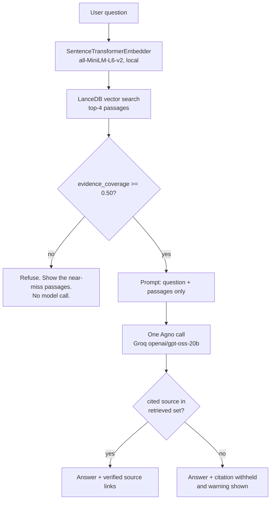

# Colab Runtime Knowledge Assistant

A retrieval-augmented question answering system for Google Colab runtimes. You ask a
question in plain language; it retrieves passages from a curated corpus of official
Colab documentation and answers using only those passages, with the sources shown.

> **If the retrieved documentation does not answer the question, it says so and
> stops.** It does not fall back on what it happens to know about Colab.


*The screenshot above is the real application, run against the committed curated
corpus with a live Groq call. It shows a real question, the generated answer with its
inline `[1]` citations, the sources the model actually used, the limits it reported,
and every retrieved passage with its source name, URL and source id.*

---

## The problem

Google Colab runtimes are rebuilt constantly. Documentation about them is spread across
a version FAQ, a developer blog, two Google-owned GitHub repositories and a published
package index. Someone reusing an old notebook has to find the right page, work out
which answer applies to which runtime version, and notice that the package list may be
two days stale.

General-purpose assistants answer such questions confidently from mixed-quality web
text, with no source you can check. The failure mode is not a wrong answer, it is a
plausible answer that nobody can verify.

## What RAG means in this project

Retrieval-Augmented Generation, applied narrowly and made inspectable:

1. **Prepare** — five curated official documents, chunked on headings.
2. **Embed and retrieve** — the question is embedded by the same local model for every
   query, and the nearest passages come back from a local vector database.
3. **Check the evidence** — deterministic code decides whether those passages actually
   cover the question. This is the part most RAG demos skip.
4. **Generate** — exactly one model call receives the question and those passages, and
   nothing else. It cites them by number.
5. **Verify the citations** — every source the model claims to have used is checked
   against the passages actually retrieved, and withheld if it was not there.

The model contributes prose. Retrieval, evidence sufficiency and citation validity are
all decided in Python.

## The evidence check

This is the part worth explaining in an interview.

A vector search **always** returns its nearest neighbours. Asking "how much RAM does a
free Colab runtime give me?" confidently returns a blog post about reproducibility and
a runtime component list. Nothing in that is about RAM. Handing those passages to a
model and asking for an answer is an invitation to invent a number.

So sufficiency is decided before generation, by ordinary Python. Each question term is
weighted by how many retrieved passages contain it:

```
weight = log(1 + N / containing)
```

A term in every passage is weighted least — "colab" appears in all of them and tells
you nothing. A term in none is weighted most — "ram" appears in no Colab source.
Coverage is the share of that weight covered by the **single best passage**, not the
pool of all of them, so several unrelated paragraphs cannot add up to apparent support.

Under the 0.50 threshold:

| Question | Coverage | Outcome |
|---|---|---|
| How do I pin a notebook to a past Colab runtime version? | 1.00 | answered |
| Where is Google Drive mounted in a Colab runtime? | 1.00 | answered |
| How long are past Colab runtime versions available? | 0.53 | answered |
| How do I use Kaggle notebooks instead of Colab? | 0.42 | **refused** |
| How much RAM does a free Colab runtime give me? | 0.30 | **refused** |

Two consequences worth being explicit about:

- It is a **lexical** measure. It needs no model call, so it is exhaustively testable
  without an API key, and it cannot be argued into agreeing with itself.
- The margin is **narrow** — 0.52 against 0.42 across the hand-written set — so this is
  a calibrated heuristic, not a classifier. It is a single visible constant in
  [`src/qa.py`](src/qa.py), not a hidden layer.

When the check fails, the model is not called at all, and the near-miss passages are
still shown so the refusal can be judged rather than trusted.

## How it works



Two independent branches leave retrieval. If the provider is unreachable, the retrieved
passages still render.

## Document preparation and chunking

Five documents in [`data/sources/`](data/sources/), all official, each carrying its
source URL and retrieval date in front matter and in
[`manifest.json`](data/sources/manifest.json):

| Source | Covers |
|---|---|
| Colab runtime version FAQ | What a runtime version is, pinning, caveats, availability, published component lists |
| Google Developers Blog (Colab team) | Why dynamic runtimes break reproducibility, pinning rationale |
| `googlecolab/backend-info` README | What the published package index is, and its one-to-two-day staleness caveat |
| `googlecolab/google-colab-cli` README | `/content/drive` mount defaults, VM filesystem operations |
| `googlecolab/colabtools` `_pip.py` | Why `pip install` warns after an import, and import-name versus distribution-name mapping |

Each document is read by `MarkdownReader` with a 600-character chunk size, so a chunk is
a section of the document rather than the whole thing. The YAML front matter is stripped
before embedding: its title and URL are already stored as metadata on every chunk, and
before this was fixed a chunk of nothing but `source_id: …` was being embedded and
ranked — it was the top hit for out-of-domain questions.

No blogs, no Stack Overflow, no scraped forum posts. If the answer is not in these five
documents, the assistant refuses.

## The two modes

The application has two tabs. They share a knowledge base and a provider, and neither
feeds the other.

**Ask a question** (primary) — the RAG system described above. A question never reaches
the rule engine; a test asserts the question tab does not even reference the auditor.

**Audit a notebook** (secondary) — unchanged deterministic analysis. Six rules in
[`src/rules.py`](src/rules.py) examine a notebook's pip installs, pins and `/content/`
paths against a vendored runtime snapshot:

| Rule | Detects | Severity |
|---|---|---|
| R001 | A pin that differs from the selected runtime snapshot | `HIGH` |
| R002 | A `pip install` with no exact pin | `ATTENTION` |
| R003 | `/content/` Colab path assumptions | `ATTENTION` |
| R004 | A package absent from the snapshot | `UNKNOWN` |
| R005 | The same package installed twice with conflicting requirements | `HIGH` |
| R006 | Insufficient evidence to conclude | `UNKNOWN` |

Findings are owned by the rule engine and are structurally unwritable by a model:
`AuditResult` has no explanation field and `ExplanationResult` has no version, severity
or status field. Evidence retrieval here exists to explain an existing finding, and the
optional AI explanation is prose about a result that already exists.

The two modes are genuinely different pipelines that happen to share an index, not one
pipeline with two prompts.

## Verification

`tests/retrieval_eval.json` holds 12 answerable questions, each paired with the source
document that actually answers it, plus 6 out-of-domain questions the corpus cannot
answer. Run it with `python scripts/run_retrieval_eval.py`:

```
answerable questions            : 12
expected source in top-4        : 12/12
expected source ranked first    : 11/12

answerable coverage range       : 0.52-1.00
out-of-domain coverage range    : 0.07-0.42
threshold in src/qa.py          : 0.50
threshold separates the two sets: yes
```

**This is not a benchmark and no accuracy figure is claimed.** Eighteen hand-written
questions cannot support one. It exists so that a change to the corpus, the chunking or
the embedding model shows up immediately instead of degrading silently.

## Technology stack

| Component | Used for |
|---|---|
| Python 3.11+ | Language |
| [Pydantic](https://docs.pydantic.dev/) | Data shapes and both output schemas |
| [Sentence Transformers](https://www.sbert.net/) | `all-MiniLM-L6-v2` local embeddings |
| [LanceDB](https://lancedb.github.io/lancedb/) | Local vector store |
| [Agno](https://docs.agno.com/) 3.x | The single agent call |
| [Groq](https://console.groq.com/) | Default provider, `openai/gpt-oss-20b` |
| [Ollama](https://ollama.com/) | Optional offline mode, `ministral-3:3b` |
| [Streamlit](https://streamlit.io/) | Web interface |

Retrieval, embeddings and the vector database all run locally. Only answer generation
calls a provider, and only when the evidence check passes.

## Installation

Requires Python 3.11+. Verified on 3.14; CI runs 3.12 and 3.13.

```bash
python -m venv .venv
.venv/bin/pip install -r requirements.txt
```

Or install from version ranges:

```bash
.venv/bin/pip install ".[llm,ui,dev]"
```

`src/` is a flat script directory, so put it on the import path:

```bash
export PYTHONPATH=src
```

An editable install does **not** work here: Python 3.14 skips the `.pth` file setuptools
generates because its name begins with `__`, so the install appears to succeed and then
imports fail. Use `PYTHONPATH=src`.

## Running it

```bash
.venv/bin/streamlit run app/streamlit_app.py
```

The Streamlit app sets up its own import path, so it needs no `PYTHONPATH`.

As a library:

```python
import qa
from knowledge_base import build_knowledge, ingest

knowledge = build_knowledge()
ingest(knowledge)

result = qa.answer_question(knowledge, "Where is Google Drive mounted in Colab?")

print(result.status)            # ok | insufficient_evidence | disabled | failed
print(result.coverage)          # measured deterministically, before any model call
print(result.used_sources)      # source ids, after citation verification
print(result.passages[0]["url"])
print(result.answer.answer)
```

Retrieval and the evidence check run whether or not a provider is configured. Pass
`use_ai=False` to get the passages and the verdict without any model call.

## Configuration

A written answer needs a Groq key:

```bash
export GROQ_API_KEY=...
```

**Without a key the system is still useful.** Retrieval, the evidence check and the full
passage display all work; the interface reports that a written answer was not generated.
This path is covered by tests.

`.env.example` is a template. **The project does not load `.env` automatically** — there
is no dotenv dependency. Export the variable, or use `.streamlit/secrets.toml`:

```toml
# .streamlit/secrets.toml — gitignored
GROQ_API_KEY = "..."
```

Optional offline mode:

```bash
export COLABAUDIT_LLM_PROVIDER=ollama
export COLABAUDIT_LLM_MODEL=ministral-3:3b
```

Needs no key, but is much slower and less complete. Why Groq is the default is in
[`AI_PROVIDER.md`](AI_PROVIDER.md).

## Running the tests

```bash
.venv/bin/python -m pytest -q
```

**114 passed, 1 skipped.** No API key, no provider calls, no local model inference. The
skipped test is a live Ollama call, opt-in with:

```bash
RUN_OLLAMA_TESTS=1 .venv/bin/python -m pytest -m integration
```

Model *wording* is never asserted — that is not a stable contract. What is tested is
what the application controls: what gets retrieved, what enters the prompt, which
citations are allowed, and what happens when evidence is missing. Generation is replaced
by a stub in those tests.

GitHub Actions runs the suite, a `pyflakes` lint and a knowledge-base rebuild on Python
3.12 and 3.13 with no secrets set.

## Project structure

```
src/qa.py                 Question answering: gate, prompt, citations
src/knowledge_base.py     Chunking, embeddings, local LanceDB retrieval
src/explainer.py          The single agent call used by both modes
src/rules.py              R001-R006, the deterministic auditor
src/runtime_checker.py    Vendored snapshot lookup
src/notebook_parser.py    Read .ipynb as JSON, extract installs and imports
src/models.py             Pydantic data shapes
app/streamlit_app.py      UI only, no analysis logic
scripts/run_retrieval_eval.py  Report the retrieval check
scripts/generate_example_qa.py Regenerate reports/example_qa.md
scripts/generate_example_report.py  Regenerate reports/example_report.md
scripts/fetch_runtimes.py Re-download runtime snapshots at pinned commits
data/sources/             Five curated official sources and manifest
data/runtimes/            Five vendored Colab runtime snapshots
tests/retrieval_eval.json 18 questions with expected sources
reports/                  Example QA and audit reports, provider evaluations
```

Reference documents: [`ARCHITECTURE.md`](ARCHITECTURE.md),
[`RULES.md`](RULES.md), [`AI_PROVIDER.md`](AI_PROVIDER.md),
[`SOURCES.md`](SOURCES.md).

The LanceDB index is not committed. It is rebuilt from the committed sources on first
use, which is what keeps the repository self-contained.

## Limitations

Stated plainly, because most of them are the interesting part.

- **The corpus is five small documents.** It covers Colab runtime versioning, package
  index freshness, `/content/` paths and pip-install semantics. It does **not** cover
  GPU and TPU availability, RAM or disk limits, session timeouts, or any specific
  third-party package. Questions about those are correctly refused.
- **The sufficiency check is lexical and its margin is narrow.** No stemming, no
  synonyms. "How much RAM…" and "What memory does Colab allocate?" would behave
  differently, because "memory" is not in the corpus and "RAM" is not either — but a
  paraphrase that shares no words with the corpus can slip past a threshold the
  vocabulary does not cover.
- **Retrieval is dense-vector only.** No BM25 hybrid, no reranker. A question phrased
  entirely in words absent from the corpus relies on the embedding model alone.
- **No score is exposed.** Agno 3.1.1 does not surface the raw similarity score on the
  returned document, so results carry a rank rather than a fabricated number. The
  coverage score is real and is computed separately, in `qa.py`.
- **Groq structured output is not fully reliable.** Agno 3.1.1 reports
  `supports_native_structured_outputs = False` for it, and observed calls have
  occasionally omitted declared fields. The schema tolerates this and the failure path
  is tested, but a degraded answer is possible.
- **The auditor analyses notebooks, never executes them.** `READY` means no issue was
  found by the supported checks. It is not a guarantee that a notebook runs.
- **Runtime snapshots are a bounded reference set** — five historical versions of
  published CI data, which Google states can lag a live runtime by a day or two.
- **Parsing is regex based, not `ast`**, so an import inside a comment can be read as a
  dependency.
- **The 18-question retrieval set is a sanity check**, not a benchmark.

## Licence and acknowledgements

Project code is MIT licensed — see [`LICENSE`](LICENSE).

This project was informed by an Agno learning notebook in my own archive, which
demonstrated the RAG pattern reused here: `Knowledge` + `LanceDb` +
`SentenceTransformerEmbedder` for retrieval, an `Agent` with a Pydantic `output_schema`
for structured output. The implementation was rewritten against the Agno 3.x API, since
the notebook used 2.x APIs that have since changed. No code was copied from it.

Third-party material bundled here:

- `data/runtimes/` contains unmodified `pip-freeze.txt` and `os-info.txt` output from
  `googlecolab/backend-info`, Copyright Google LLC, licensed Apache-2.0.
- `data/sources/` contains short quotations and close paraphrases of public Google Colab
  documentation, each attributed with its source URL and retrieval date.

See [`SOURCES.md`](SOURCES.md) for full provenance.