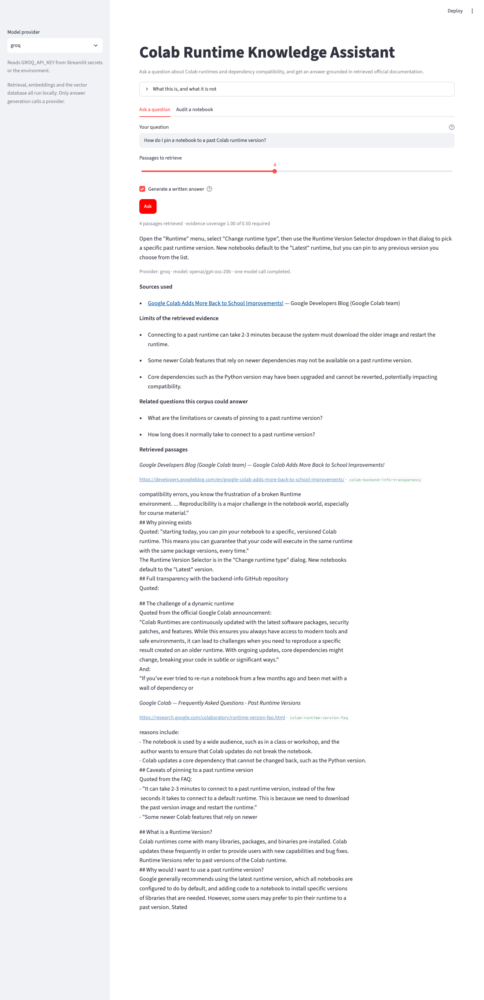
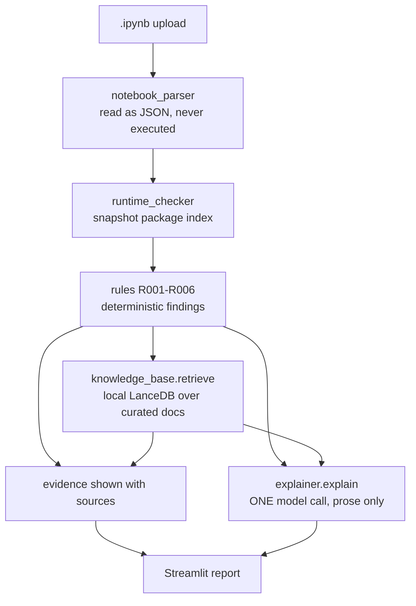

# Colab Notebook Compatibility Auditor

A Python tool that checks Google Colab notebooks for selected dependency and runtime
compatibility risks, then uses retrieved official documentation to explain the findings.

> **It analyses notebooks. It does not execute them.**
> A `READY` result means no issue was found by the supported checks. It is not a
> guarantee that the notebook will run.



*The screenshot above is the real application, run against the committed test fixture
`tests/fixtures/mismatching_pin.ipynb` and the `2026.07` runtime snapshot. It shows the
three stages the tool produces: deterministic findings, retrieved evidence with source
links, and a single AI explanation.*

---

## The problem

Colab runtimes are rebuilt frequently. A notebook written a year ago can

- pin a package version the current runtime no longer ships,
- install packages with no version pin at all, so the resolved version can drift,
- rely on packages that are not in the runtime,
- assume Colab-specific filesystem paths such as `/content/`.

Reusing such a notebook produces cryptic errors long after the cause. Finding them by
hand means reading install cells, remembering what changed, and guessing.

## What the auditor checks

Six deterministic rules, implemented in [`src/rules.py`](src/rules.py):

| Rule | What it detects | Severity |
|---|---|---|
| **R001** | Notebook pins an exact version that differs from the selected runtime snapshot | `HIGH` |
| **R002** | A `pip install` with no exact version pin | `ATTENTION` |
| **R003** | `/content/` Colab path assumptions | `ATTENTION` |
| **R004** | A package not listed in the selected runtime snapshot | `UNKNOWN` |
| **R005** | The same package installed twice with different requirements | `HIGH` |
| **R006** | Insufficient evidence to conclude, e.g. an unparseable notebook or no snapshot selected | `UNKNOWN` |

Full definitions, detection logic and per-rule limitations: [`RULES.md`](RULES.md).

Findings roll up into a status, worst first:

`HIGH` → `HIGH_RISK`, else `ATTENTION`, else `UNKNOWN`, else `READY`

## Three outputs, deliberately separated

This distinction is the core design decision, and it is enforced by the type system
rather than by prompt wording:

1. **Deterministic findings** — produced by the rule engine. They own `rule`, `package`,
   `severity`, `status`, `message` and `cell`.
2. **Retrieved evidence** — chunks from a curated corpus of official Colab
   documentation, shown with source title and URL *before* any model text.
3. **AI explanation** — prose only. `ExplanationResult` has no version, severity or
   status field, and `AuditResult` has no explanation field, so the two cannot merge.

The model never decides whether a rule fired, never chooses what to search, and never
starts an agentic browsing loop. Retrieval is a direct Python call, one search per
distinct rule.

## How it works



Two independent branches leave the rule engine. If the provider is unavailable, the
deterministic report and the evidence still render on their own.

## Example result

Auditing `tests/fixtures/mismatching_pin.ipynb` against snapshot `2026.07`:

```json
{
  "rule": "R001",
  "package": "numpy",
  "severity": "HIGH",
  "status": "RISK",
  "message": "Notebook pins numpy==1.24.3 but the selected runtime contains 2.0.2.",
  "cell": 0
}
```

A longer, genuine end-to-end report is in
[`reports/example_report.md`](reports/example_report.md).

## Technology stack

| Component | Used for |
|---|---|
| Python 3.11+ | Language |
| [Pydantic](https://docs.pydantic.dev/) | Data shapes and the explanation schema |
| [Agno](https://docs.agno.com/) 3.x | The single explanation agent |
| [Sentence Transformers](https://www.sbert.net/) | `all-MiniLM-L6-v2` local embeddings |
| [LanceDB](https://lancedb.github.io/lancedb/) | Local vector store |
| [Groq](https://console.groq.com/) | Default explanation provider, `openai/gpt-oss-20b` |
| [Ollama](https://ollama.com/) | Optional fully offline mode, `ministral-3:3b` |
| [Streamlit](https://streamlit.io/) | Web interface |

The deterministic audit, the retrieval layer and the whole test suite run without
calling any LLM provider.

## Installation

Requires Python 3.11 or newer. Verified on Python 3.14 and CI-tested on 3.12 and 3.13.

```bash
python -m venv .venv
.venv/bin/pip install -r requirements.txt
```

`requirements.txt` is the pinned, macOS-verified lockfile. To install from ranges
instead:

```bash
.venv/bin/pip install ".[llm,ui,dev]"
```

`src/` is a flat script directory rather than an installed package, so put it on the
import path when using the Python API:

```bash
export PYTHONPATH=src
```

An editable install does **not** work here: Python 3.14 skips the `.pth` file setuptools
generates because its name begins with `__`, so the install appears to succeed and then
the imports fail. Use `PYTHONPATH=src`.

## Running the application

```bash
.venv/bin/streamlit run app/streamlit_app.py
```

Upload a `.ipynb`, pick a runtime snapshot, press **Analyze**.

The Streamlit app handles its own `sys.path`, so it needs no `PYTHONPATH` and no install
step.

### Using it as a library

```python
import rules

result = rules.audit_notebook("my_old_notebook.ipynb", "2026.07")
print(result.status)          # READY | ATTENTION | HIGH_RISK | UNKNOWN
```

To include evidence and the AI explanation, call the same three plain functions the app
calls:

```python
from explainer import collect_evidence, explain
from knowledge_base import build_knowledge, ingest

knowledge = build_knowledge()
ingest(knowledge)                          # rebuilds the index from data/sources/

result = rules.audit_notebook("my_old_notebook.ipynb", "2026.07")
evidence = collect_evidence(knowledge, result)   # deterministic, one search per rule
explanation = explain(result, evidence)          # one model call, prose only

print(evidence["R001"][0]["url"])         # inspectable before any model call
print(explanation.summary)
```

Findings are deduplicated by rule before retrieval, so a notebook with many findings
still costs **one** model call.

## API key

The AI explanation needs a Groq key:

```bash
export GROQ_API_KEY=...
```

**Without a key the tool is still useful.** Parsing, the rule engine, runtime checking
and evidence retrieval all work, and the UI reports the AI step as unavailable rather
than failing.

`.env.example` is a template. **This project does not load `.env` automatically** —
there is no dotenv dependency. Export the variable in your shell, or put it in
`.streamlit/secrets.toml`:

```toml
# .streamlit/secrets.toml — gitignored, never commit
GROQ_API_KEY = "..."
```

### Optional offline mode

To explain findings with no hosted provider at all, using a local Ollama model:

```bash
export COLABAUDIT_LLM_PROVIDER=ollama
export COLABAUDIT_LLM_MODEL=ministral-3:3b
```

This needs no API key but is roughly 30x slower and less complete than Groq. Why Groq is
the default, with the measurements behind it, is in [`AI_PROVIDER.md`](AI_PROVIDER.md).

## Running the tests

```bash
.venv/bin/python -m pytest -q
```

**69 passed, 1 skipped.** No API key, no network calls to any provider, and no local
model inference. The skipped test is a live Ollama call, opt-in with:

```bash
RUN_OLLAMA_TESTS=1 .venv/bin/python -m pytest -m integration
```

The retrieval tests build a real LanceDB index and download the embedding model on first
run, so the suite is not fully offline; nothing else reaches the network.

A [GitHub Actions workflow](.github/workflows/tests.yml) runs the suite, a `pyflakes`
lint and a knowledge-base rebuild check on Python 3.12 and 3.13 with no secrets set.

## Project structure

```
src/notebook_parser.py    Read .ipynb as JSON, extract pip installs and imports
src/runtime_checker.py    Load a vendored runtime snapshot, look up versions
src/rules.py              R001-R006 and status aggregation
src/knowledge_base.py     Curated sources, embeddings, local LanceDB retrieval
src/explainer.py          The single Agno call and its prompt
src/models.py             Pydantic data shapes
app/streamlit_app.py      UI only, no analysis logic
scripts/fetch_runtimes.py Re-download runtime snapshots at pinned commits
scripts/compare_providers.py  Provider comparison harness
tests/                    pytest suite plus eight notebook fixtures
data/runtimes/            Five vendored Colab runtime snapshots
data/sources/             Five curated official sources and their manifest
reports/                  Example report, provider evaluations, repository audit
assets/app-preview.png    Screenshot of the real application
```

Reference documents: [`ARCHITECTURE.md`](ARCHITECTURE.md) (pipeline and responsibility
boundary), [`RULES.md`](RULES.md), [`AI_PROVIDER.md`](AI_PROVIDER.md) (provider
configuration and the measured selection), [`SOURCES.md`](SOURCES.md) (provenance).

The generated LanceDB index is **not** committed. It is rebuilt from the committed
curated sources on first use, which is what makes the repository self-contained.

## Data and source provenance

Everything the tool compares against is vendored in the repository, so an audit is
reproducible without network access.

- **Runtime snapshots** — `data/runtimes/` holds `pip-freeze.txt` and `os-info.txt` from
  [googlecolab/backend-info](https://github.com/googlecolab/backend-info) for five Colab
  runtime versions (`2025.07` through `2026.07`), each at a pinned commit recorded in its
  `manifest.json`. Refetch with `python scripts/fetch_runtimes.py`.
- **Curated documentation** — `data/sources/` holds five short documents drawn from
  [Google Colab documentation](https://research.google.com/colaboratory/runtime-version-faq.html)
  and the `googlecolab` GitHub organisation. No blogs, no Stack Overflow, no SEO content.
  Each records its source URL and retrieval date in its front matter and in
  `data/sources/manifest.json`.

Google's own README notes the published package lists reflect the most recent CI
submission rather than the live runtime, and may be one or two days behind.

## Limitations and trade-offs

- **The notebook is analysed, never executed.** Static text analysis cannot see runtime
  behaviour, data shapes, network access or API failures.
- **`READY` is not a guarantee.** It means the supported checks found nothing.
- **Runtime snapshots are a bounded reference dataset.** Five historical versions, not
  the live runtime. Google states its published lists can lag by a day or two.
- **The rule engine covers only R001–R006.** Anything outside those rules is not
  detected. There is no dependency resolution and no solver.
- **Parsing is regex-based, not `ast`.** An `import` inside a comment or docstring can be
  read as a dependency.
- **The import-to-distribution map has six entries** (`sklearn`, `cv2`, `bs4`, `PIL`,
  `yaml`, `dotenv`). An unmapped name mismatch is reported as an absent package, which
  produces a conservative `UNKNOWN`.
- **The evidence corpus is five small documents** covering Colab runtime versioning and
  `/content/` paths. It cannot explain a specific third-party package's breaking
  changes.
- **The AI explanation is secondary.** It can be wrong, and one call in roughly fourteen
  observed failed to parse. The deterministic findings stand on their own and are never
  overwritten.
- **Retrieval relevance is not scored numerically**, so no retrieval metric is claimed.
- **No accuracy figure is claimed.** The provider comparison used two cases per provider.
  It was an engineering selection, not a benchmark.

Measured on 83 archived Colab notebooks: every file parsed without error (66 `ATTENTION`,
17 `READY`). R001 and R005 fired zero times on that archive because none of those
notebooks pins a version; the test fixtures exercise both.

## Licence and acknowledgements

Project code is MIT licensed — see [`LICENSE`](LICENSE).

This project was informed by an Agno learning notebook in my own archive, which
demonstrated the RAG pattern reused here: `Knowledge` + `LanceDb` +
`SentenceTransformerEmbedder` for retrieval, an `Agent` with a Pydantic
`output_schema` for structured output. The implementation was rewritten against the
Agno 3.x API, since the notebook used 2.x APIs that have since changed. No code was
copied from it, and the unrelated demos in that notebook (web-research teams, finance
tools, memory, vision, custom tools) were deliberately not carried over.

Third-party material bundled in this repository:

- `data/runtimes/` contains unmodified `pip-freeze.txt` and `os-info.txt` output from
  `googlecolab/backend-info`, Copyright Google LLC, licensed Apache-2.0.
- `data/sources/` contains short quotations and close paraphrases of public Google Colab
  documentation, each attributed with its source URL and retrieval date.

See [`SOURCES.md`](SOURCES.md) for full provenance.